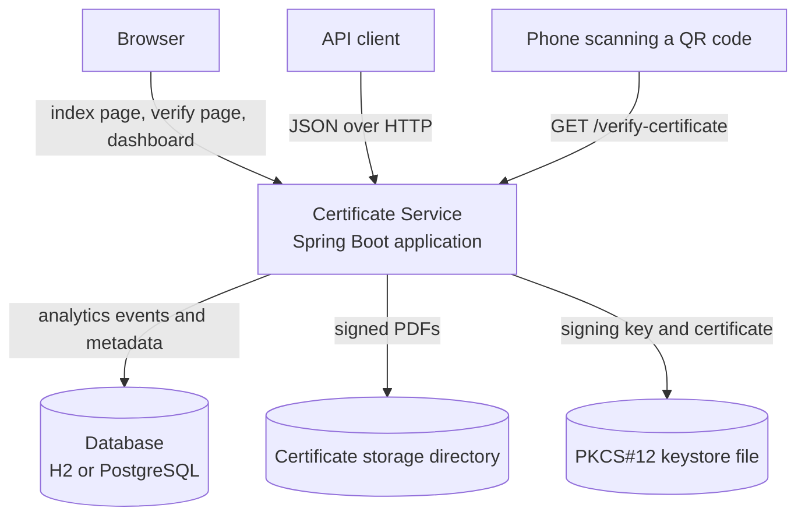
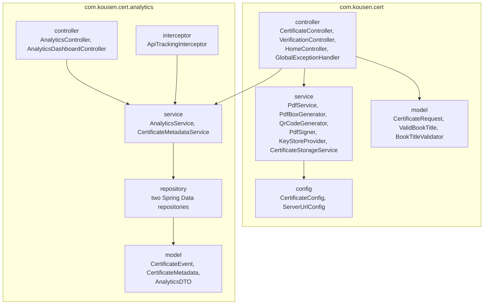
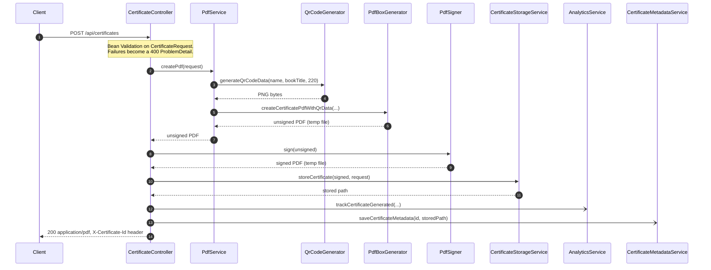
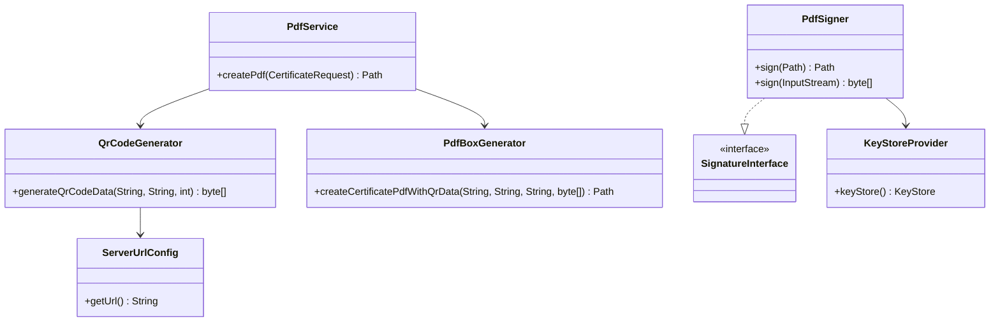
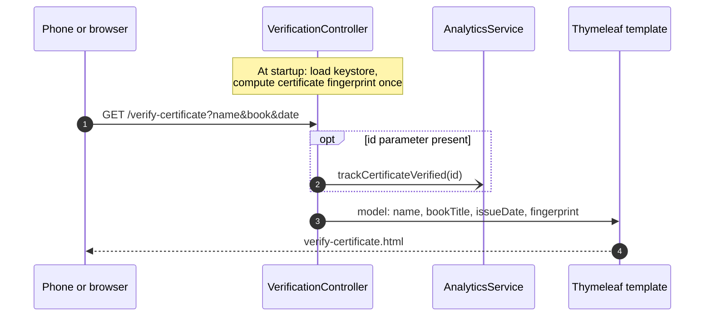
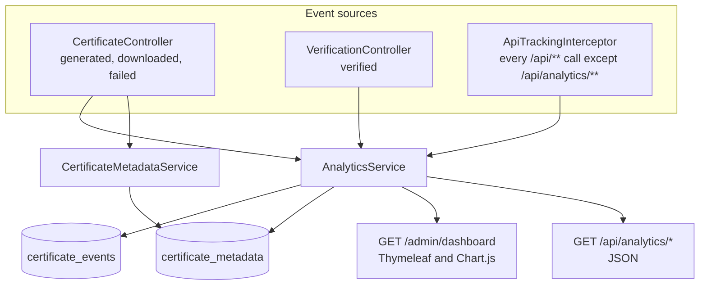
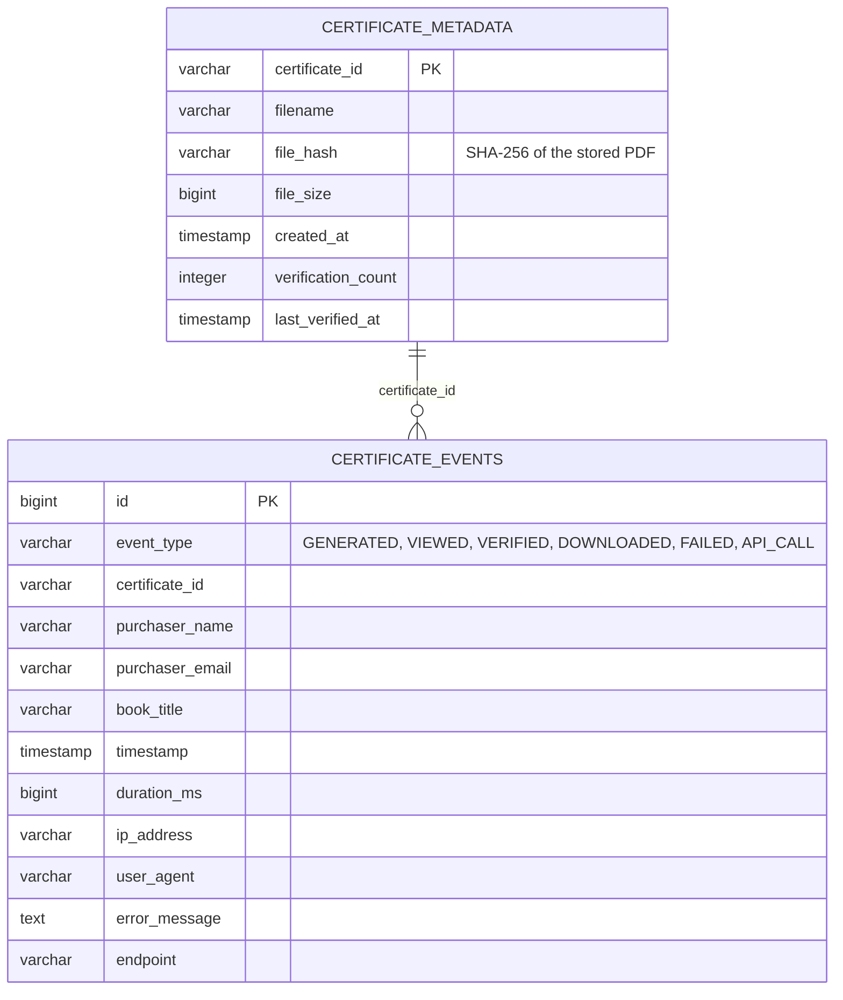
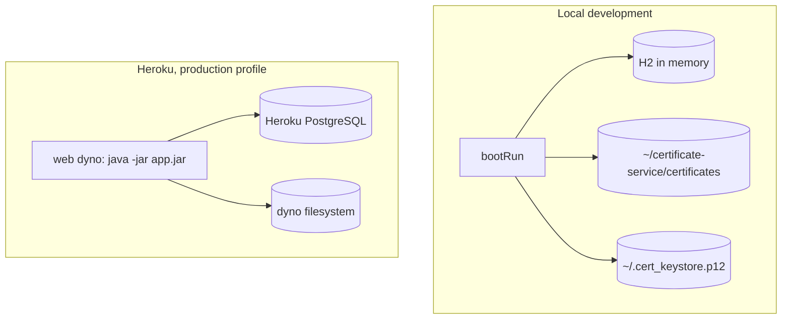

# Certificate Service Architecture

How the service is put together, for developers who need to change it. Every diagram and claim here was checked against the source on 2026-11-11. For setup and API usage, see [README.md](README.md).

## At a glance

Certificate Service is a single Spring Boot 3.4 application on Java 21. One request does most of the work: `POST /api/certificates` validates a purchaser name and book title, draws a PDF, signs it, stores a copy, and returns it. A separate analytics package records what happened and serves a dashboard.

| Concern | Choice |
|---|---|
| Web | Spring MVC on virtual threads (`spring.threads.virtual.enabled`) |
| PDF drawing | Apache PDFBox 3 |
| Signing | PDFBox signature API with BouncyCastle, self-signed RSA 4096 |
| QR codes | ZXing |
| Persistence | Spring Data JPA: H2 in memory by default, PostgreSQL when `DATABASE_URL` is set |
| Server-rendered pages | Thymeleaf, with Chart.js on the dashboard |
| Tests | JUnit 5, Mockito, jqwik, Testcontainers |

## System context

The application talks to three things outside its own process: a relational database, a directory of stored PDFs, and a PKCS#12 keystore file.

## Packages

Two halves share one application context. The certificate core has no database access of its own; everything that touches JPA lives under `analytics`.

The only dependency from the core into analytics is the controllers calling `AnalyticsService` and `CertificateMetadataService` to record what they did.

## Certificate generation

Points worth knowing:

- **The controller orchestrates.** `PdfService` only draws; `CertificateController` calls the signer, storage and analytics itself.
- **The certificate id is a random UUID** created in the controller. It is returned in the `X-Certificate-Id` header and used as the metadata key. It is not printed on the PDF or encoded in the QR code.
- **Steps 12 and 13 are fire-and-forget.** Both return a `CompletableFuture` that the controller ignores, and both catch and log their own failures, so analytics problems never fail a request.
- **Validation is declarative.** `@NotBlank`, `@Email` and the custom `@ValidBookTitle` (an allowlist in `CertificateRequest.ALLOWED_BOOK_TITLES`) sit on the record; `GlobalExceptionHandler` turns violations into RFC 7807 responses.
- **A generation failure is not mapped.** An `IOException` from drawing or signing is recorded with `trackCertificateError` and then surfaces as a plain 500.

## PDF drawing and signing

- **Drawing.** `PdfBoxGenerator` produces one landscape A4 page: a background image, two decorative TrueType fonts loaded from the classpath with Helvetica fallbacks, centred text, and the QR code bottom left. If saving fails it retries with standard fonts only.
- **QR content.** `QrCodeGenerator` encodes a URL of the form `{base-url}/verify-certificate?name=…&book=…&date=…`. The base URL comes from `certificate.verification.base-url`, which defaults to `server.url`.
- **Signing.** `PdfSigner` adds a detached PKCS#7 signature (`adbe.pkcs7.detached`, SHA512withRSA) using the `authorKey` entry in the keystore.
- **Key material.** `CertificateConfig` declares one `KeyStoreProvider` bean, built from `certificate.keystore` and shared by the signer and the verification page. It loads the keystore if the file exists and otherwise generates a 4096-bit RSA key with a self-signed certificate valid for ten years, then writes the file. The password comes from `CERT_PWD` (environment variable, then system property), defaulting to `changeit`.

## Verification

Scanning the QR code opens a server-rendered page. Nothing is looked up: the page echoes the query parameters and shows the SHA-256 fingerprint of the signing certificate, so a reader can compare it with the signature inside the PDF.

## Analytics

- **Writes are asynchronous.** Tracking methods run on a background thread, save a `CertificateEvent`, and update Micrometer counters and timers.
- **Reads are live queries.** `AnalyticsService.getDashboardData()` builds the whole dashboard from `certificate_events` and `certificate_metadata` on each call. All five `/api/analytics/*` endpoints call it and return one slice.
- **There is no pre-aggregation.** A scheduled aggregation service and its `aggregated_metrics` table were removed on 2026-11-11 because nothing read them. A database created before that still has the unused table; Hibernate's `update` mode does not drop it.
- **The request is read before going async.** The client IP (first `X-Forwarded-For` entry, else the remote address) and user agent are copied on the request thread, because the container recycles the request object once the response completes.

### Data model

The link between events and metadata is by value only; there is no foreign key. Hibernate creates and updates the schema (`ddl-auto`), so there are no migration scripts.

## Runtime and deployment

- **Local:** everything defaults to the home directory and an in-memory database, so analytics data is lost on restart.
- **Production:** `Procfile` runs the boot jar, `system.properties` pins Java 21, and `DATABASE_URL` switches the datasource to PostgreSQL. The `production` profile turns off the H2 console and tunes the connection pool.
- **Dyno storage is not durable.** Stored PDFs and a generated keystore live on the dyno's own disk, which Heroku replaces on restart. A new keystore means a new signing certificate and a new fingerprint.

All settings and their environment variables are listed in the [README configuration section](README.md#configuration).

## Tests

| Kind | Examples | What it loads |
|---|---|---|
| Plain unit | `GlobalExceptionHandlerTest`, `ApiTrackingInterceptorTest`, `KeyStoreProviderTest` | No Spring context |
| Property-based (jqwik) | `BookTitleValidatorPropertyTest`, `PdfBoxGeneratorPropertyTest`, `PdfSignerPropertyTest` | No Spring context; 2 to 5 tries where PDFs or RSA keys are involved |
| Web slice | `CertificateControllerTest`, `AnalyticsControllerTest` | `@WebMvcTest` with `@MockitoBean` collaborators |
| Full context | `VerificationControllerTest`, `CertificateServiceIntegrationTest` | `@SpringBootTest` on H2 |
| Database integration | `AnalyticsIntegrationTest` | `@SpringBootTest` against PostgreSQL in Testcontainers; skipped when Docker is absent |

Every test run produces a JaCoCo report. Coverage minimums are opt-in through `./gradlew jacocoTestCoverageVerification` and are not part of `check`. `config`, `model` and `Application` are excluded from coverage.

## Known gaps

These are current behaviours a maintainer should know about, not design goals.

1. **No authentication.** There is no Spring Security dependency. `/admin/dashboard`, `/api/analytics/*`, the stored-certificate endpoints and (outside the production profile) `/h2-console` are open.
2. **QR links carry no certificate id.** `VerificationController` only tracks a verification when an `id` parameter is present, and `QrCodeGenerator` does not add one, so scans are not counted.
3. **Signed temp files accumulate.** The unsigned PDF is deleted after each request, and a failed generation removes its own temp file; the signed temp file returned to the client is never deleted.
4. **Unused template.** `templates/verification-page.html` is not referenced by any controller.
5. **A bad keystore stops startup.** The `KeyStoreProvider` bean fails fast if the keystore file exists but cannot be loaded, for example with the wrong `CERT_PWD`.
6. **PDF fallback is untested.** The standard-fonts retry in `PdfBoxGenerator` only runs when saving fails and has no test.
