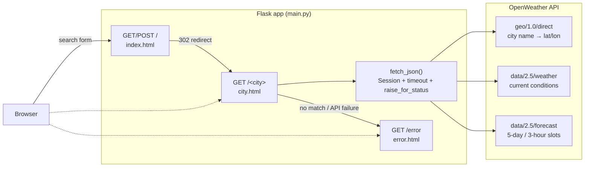
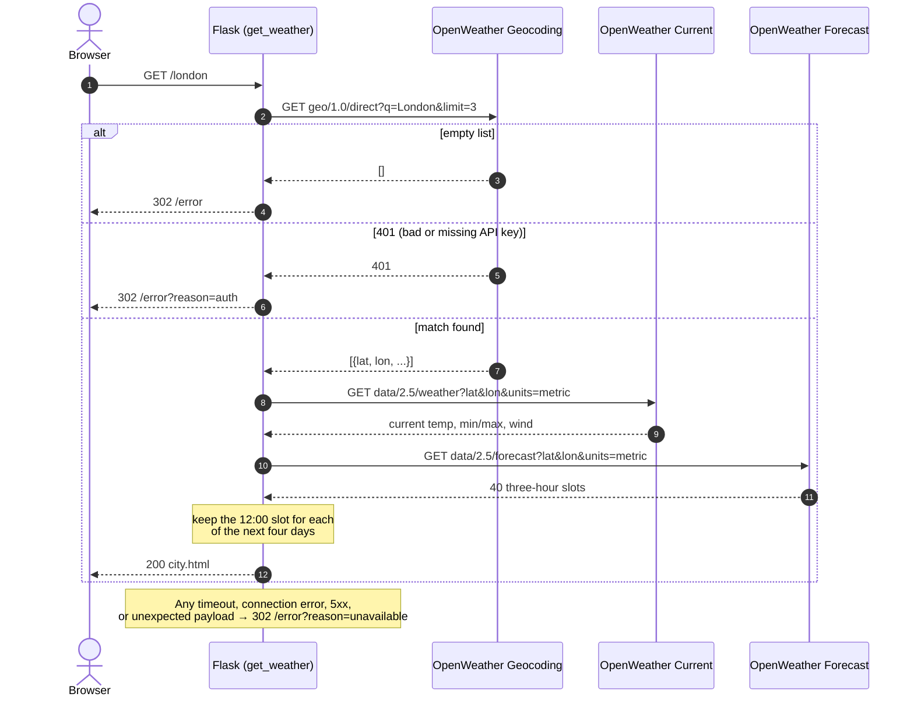

# Weather App

A small Flask application that shows the current weather and a four-day forecast for any city, using the free OpenWeather APIs. It is one of the sample projects in the Claude Code training course, used for the codebase-exploration, testing, error-handling, and documentation labs.

The app was originally written by [Rachana Hegde](https://rachanahegde.squarespace.com/) as a portfolio project. The UI, CSS, and templates are hers; this fork adds tests and error handling for teaching purposes.

## Screenshots

| Home | Forecast | Error |
|------|----------|-------|
|  |  |  |

The layout is responsive. Mobile views are in `screenshots/`.

## Architecture

Everything lives in `main.py`: three Flask routes, one HTTP helper, and no database. All weather data comes from three OpenWeather endpoints on each city lookup.



### Request flow for a city lookup



### Notes on the design

- **Geocoding first.** The current-weather and forecast endpoints take coordinates, so every lookup starts by resolving the city name. The app requests up to three matches but uses only the first.
- **Forecast filtering.** The forecast endpoint returns 3-hour slots in UTC. The app keeps the 12:00 slot for each of the next four days and labels each one from its own date, so labels and temperatures cannot drift apart when today's noon slot is absent after 12:00 UTC.
- **One HTTP helper.** `fetch_json` reuses a single `requests.Session`, applies a 3-second connect and 5-second read timeout, and calls `raise_for_status` on every response. Failures are logged with a traceback and redirected to the error page with a reason, so the user never sees a stack trace.
- **Temperatures are metric.** The `units=metric` parameter is set on both weather calls.

## Running locally

Requires Python 3.11 or later and a free [OpenWeather API key](https://openweathermap.org/appid).

```bash
python -m venv .venv
source .venv/bin/activate          # Windows: .venv\Scripts\activate
pip install -r requirements-dev.txt
echo 'OWM_API_KEY=your-key-here' > .env
python main.py
```

Open http://127.0.0.1:5000, type a city, and press Enter. The dev server runs with `debug=True`, so edits to `main.py` or the templates reload automatically.

The `.env` file is gitignored. If `OWM_API_KEY` is missing the app still starts, logs a warning, and every lookup lands on the error page with an "API key" message.

For a production-style run, the `Procfile` uses gunicorn:

```bash
gunicorn main:app
```

## Tests

```bash
python -m pytest -q
```

The suite in `test_main.py` covers every route without touching the network. A fixture patches the session's `get` method with a dispatcher keyed on endpoint URL, and a second fixture freezes the clock so the forecast filtering is deterministic. Tests cover the happy path, the forecast day-selection rules, unknown cities, the catch-all route, and each failure mode: HTTP errors on all three calls, timeouts, connection errors, a 401, and a 200 with an unexpected body.

## Project layout

```
main.py                 Flask app: routes, fetch_json helper, forecast filtering
test_main.py            pytest suite (mocked HTTP, frozen clock)
templates/              index.html (search), city.html (forecast), error.html
static/css/main.css     Responsive layout: CSS grid, flexbox, media queries
static/assets/          Weather icons named after OpenWeather's condition strings
screenshots/            Desktop and mobile screenshots used above
requirements.txt        Runtime deps: Flask, requests, python-dotenv, gunicorn
requirements-dev.txt    Runtime deps plus pytest
Procfile                gunicorn entry point for Heroku-style hosts
EXERCISE.md             Lab instructions for the training course
```

Weather icons are looked up by lowercasing the condition string OpenWeather returns, so `Clouds` renders `static/assets/clouds.png`. The set covers Clear, Clouds, Drizzle, Rain, Thunderstorm, Snow, Mist, Fog, Haze, Smoke, and Tornado.

## Known limitations

- **US city and state lookups fail.** OpenWeather reads the second comma-separated token as a country code, so `Austin, TX` returns nothing while `Austin, TX, US` works. Full state names such as `Austin, Texas` are silently ignored and only work when the intended city happens to be the first match.
- **Ambiguous names pick the first result.** `Springfield` returns Illinois. The three results the app already requests could drive a disambiguation page.
- **The city route is a catch-all.** Any unknown path, including `/favicon.ico`, is treated as a city name and triggers a geocoding call.
- **No caching.** Each lookup makes three API calls. Coordinates for a given name never change, so the geocoding step is a natural candidate for `functools.lru_cache`.
- **Forecast shows the noon temperature only,** not the daily low and high.

## Credits

Original application by [Rachana Hegde](https://rachanahegde.squarespace.com/).

### Images

- [Home page background image](https://unsplash.com/photos/2KXEb_8G5vo)
- [Error page desktop background image](https://unsplash.com/photos/U-Kty6HxcQc)

### Icons

- <a target="_blank" href="https://icons8.com/icon/pLiaaoa41R9n/wind">Wind</a> icon by <a target="_blank" href="https://icons8.com">Icons8</a>
- <a target="_blank" href="https://icons8.com/icon/37802/thermometer">Thermometer</a> icon by <a target="_blank" href="https://icons8.com">Icons8</a>
- <a target="_blank" href="https://icons8.com/icon/99328/clouds">Clouds</a> icon by <a target="_blank" href="https://icons8.com">Icons8</a>
- <a target="_blank" href="https://icons8.com/icon/101829/rain">Rain</a> icon by <a target="_blank" href="https://icons8.com">Icons8</a>
- <a target="_blank" href="https://icons8.com/icon/67657/fog">Fog</a> icon by <a target="_blank" href="https://icons8.com">Icons8</a>
- <a target="_blank" href="https://icons8.com/icon/hXkspV0LTEoE/snow">Snow</a> icon by <a target="_blank" href="https://icons8.com">Icons8</a>
- <a target="_blank" href="https://icons8.com/icon/G3xS4dQTvswX/rainy-weather">Rainy Weather</a> icon by <a target="_blank" href="https://icons8.com">Icons8</a>
- <a target="_blank" href="https://icons8.com/icon/101843/storm">Storm</a> icon by <a target="_blank" href="https://icons8.com">Icons8</a>
- <a target="_blank" href="https://icons8.com/icon/59878/search">Search</a> icon by <a target="_blank" href="https://icons8.com">Icons8</a>
- <a target="_blank" href="https://icons8.com/icon/39789/chevron-left">Chevron Left</a> icon by <a target="_blank" href="https://icons8.com">Icons8</a>
- <a target="_blank" href="https://icons8.com/icon/99362/summer">Summer</a> icon by <a target="_blank" href="https://icons8.com">Icons8</a>
- <a target="_blank" href="https://icons8.com/icon/akbaie9da2Be/tornado">Tornado</a> icon by <a target="_blank" href="https://icons8.com">Icons8</a>
