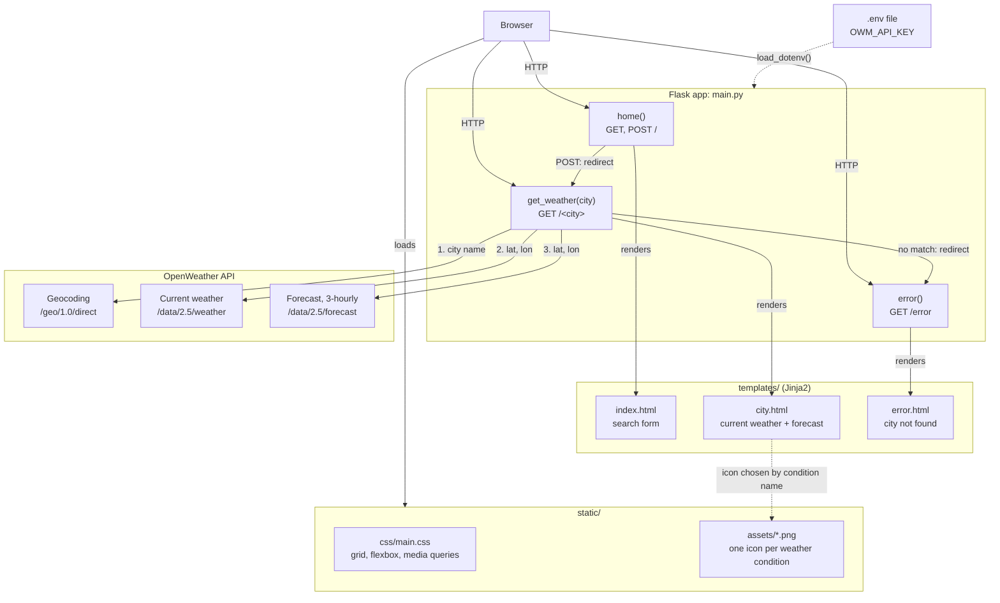
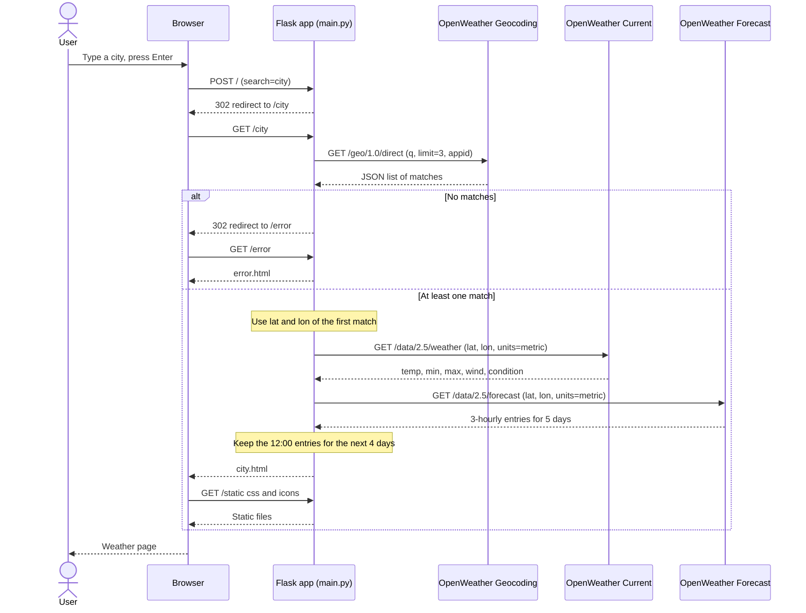
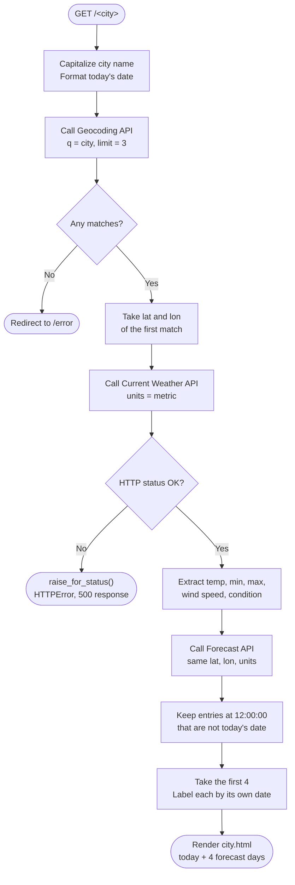

# Weather App Architecture

## Components

The browser, the three Flask routes, the templates and static assets they use, and the three OpenWeather endpoints.

## Request sequence

One city search from form submit to rendered page, including the no-match branch.

## `get_weather()` flow

The decision logic inside the `/<city>` route in `main.py`.

