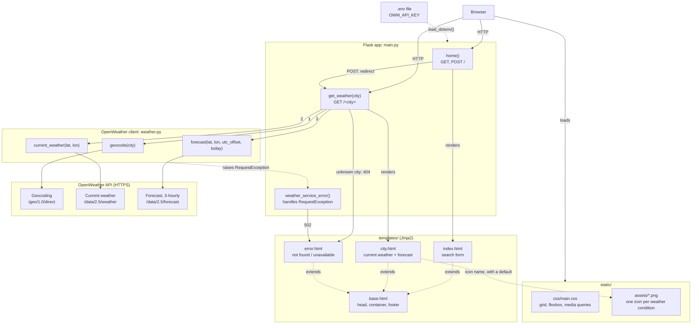
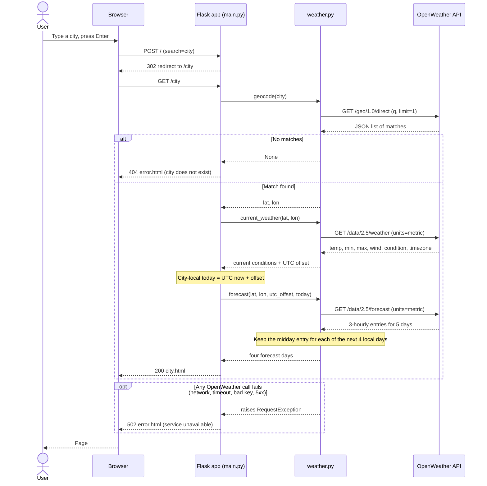
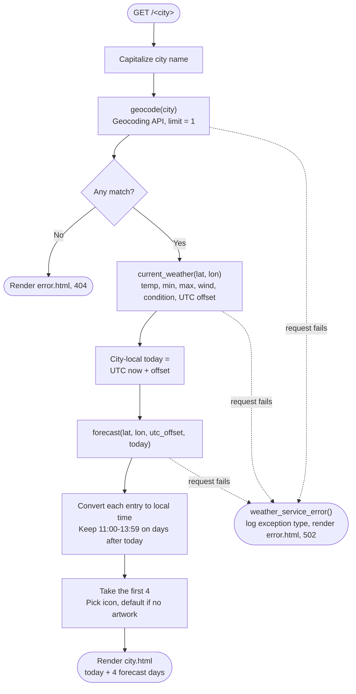

# Weather App Architecture

## Components

The browser, the two Flask routes and the error handler, the OpenWeather client module, the templates and static assets, and the three OpenWeather endpoints.

## Request sequence

One city search from form submit to rendered page, including the unknown-city and service-failure branches.

## `get_weather()` flow

The decision logic for the `/<city>` route across `main.py` and `weather.py`.

